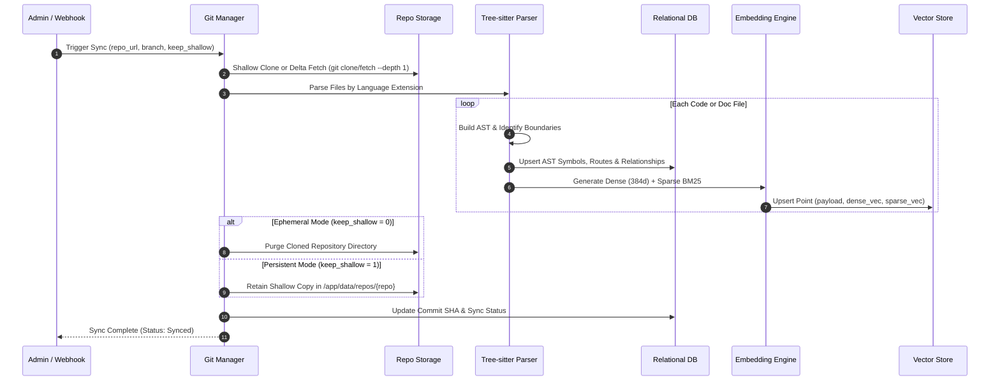
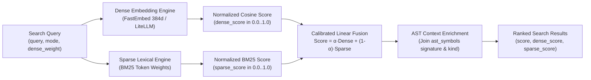
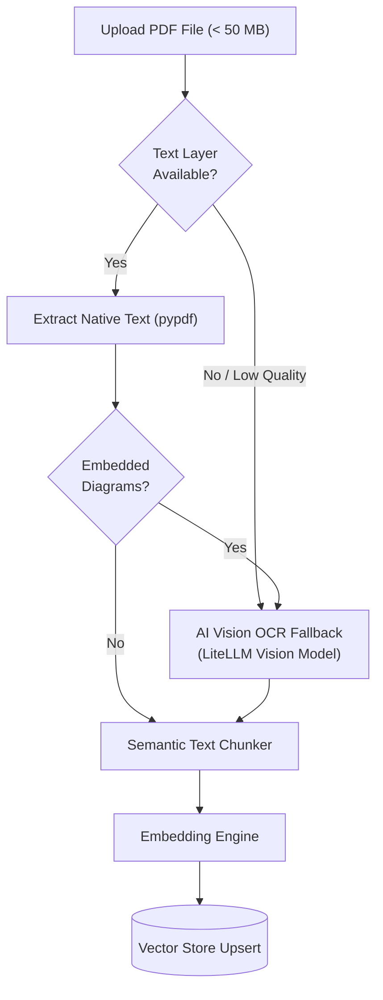

# Data Pipeline and Ingestion

This document details the data ingestion, Tree-sitter AST parsing, semantic chunking, calibrated hybrid search scoring, and PDF vision OCR pipelines.

---

## Ingestion and Chunking Sequence

The following sequence diagram illustrates the lifecycle of a repository synchronization request:



---

## 1. Syntax-Aware AST Chunking

Unlike naive fixed-window chunkers, ContextCortex uses Tree-sitter grammars to parse source code files into concrete syntax trees.

### Supported Language Grammars
ContextCortex includes pre-compiled Tree-sitter grammars for 10 programming languages:
- Python (`.py`)
- TypeScript / JavaScript (`.ts`, `.tsx`, `.js`, `.jsx`)
- Go (`.go`)
- Rust (`.rs`)
- C# (`.cs`)
- C / C++ (`.c`, `.cpp`, `.h`, `.hpp`)
- Java (`.java`)
- Ruby (`.rb`)
- PHP (`.php`)

### Chunking Logic & Large File Summarization
1. The parser identifies high-level AST nodes (`function_definition`, `class_definition`, `method_declaration`, `interface_declaration`, `struct_specifier`).
2. If a node size is within the maximum token threshold (512 tokens), the system preserves the node as an atomic chunk.
3. If a class or function exceeds the threshold, the system splits child blocks while preserving the parent declaration header.
4. Each chunk preserves exact source metadata: `filepath`, `start_line`, `end_line`, `symbol_name`, `signature`, and `language`.
5. For files exceeding the large-file threshold (default `500 KB`), ContextCortex generates a structured LLM executive summary (`doc_type="summary"`) and caches it in SQLite while allowing bounded line-range reads via `read_file`.

---

## 2. Calibrated Hybrid Search & AST Context Enrichment

ContextCortex combines dense semantic embeddings and sparse lexical BM25 embeddings with configurable fusion weights and AST signature enrichment.



### Calibrated Linear Fusion Formula
For a candidate chunk `d`, the normalized dense semantic score (`DenseScore(d)` in `[0.0, 1.0]`) and normalized sparse lexical score (`SparseScore(d)` in `[0.0, 1.0]`) are combined using the active `dense_weight` (`α`):

```text
FinalScore(d) = (α × DenseScore(d)) + ((1.0 - α) × SparseScore(d))
```

Where:
- `α` (`dense_weight`) ranges from `0.0` to `1.0` (default `0.5` balanced):
  - **Hybrid Mode (`mode = "hybrid"`)**: Uses the caller-supplied `dense_weight` or `HYBRID_DENSE_WEIGHT` (default `0.5`).
  - **Semantic Mode (`mode = "semantic"`)**: Sets `α = 1.0` (queries dense vectors only).
  - **Lexical Mode (`mode = "lexical"`)**: Sets `α = 0.0` (queries sparse BM25 tokens only).
- Both component scores (`dense_score` and `sparse_score`) are returned alongside the fused `score` so users and AI agents can see whether a match originated from conceptual similarity or exact identifier hits.

### AST Context Enrichment
When querying code (`doc_type = "code"`), `execute_hybrid_search` joins each vector hit against the relational `ast_symbols` table by `repo`, normalized `filepath`, and overlapping `start_line`–`end_line` span. This enriches every result with:
- Qualified symbol path (`full_symbol`, e.g., `ProvidersController.GetAuthProviders`)
- Extracted method or class signature (`signature`)
- Normalized AST kind (`function`, `method`, `class`, `interface`) and `ast_symbol_id`

---

## 3. PDF Document Ingestion and Vision OCR

When administrators upload PDF files to managed local storage:



1. **Native Text Extraction**: The system extracts digital text per page using `pypdf`.
2. **Quality Evaluation**: If a page contains minimal digital text or scanned bitmaps, the system flags the page for OCR.
3. **AI Vision OCR**: ContextCortex renders flagged pages and queries the configured vision model (for example, `gemini-2.5-flash` or `qwen3-vl`) to transcribe technical text and architectural diagrams.
4. **Interactive Preview**: Users review extracted page text, sample chunks, and OCR indicators in the dashboard modal before confirming vector ingestion.

---

## Related Architecture Guides
- [System Design and Components](/architecture/system-design)
- [MCP Protocol and Security](/architecture/mcp-protocol)
- [Database and Storage Schema](/architecture/database-schema)
