# Database and Storage Schema

This document details the unified SQLAlchemy 2.0 relational data model, entity relationships, and vector storage payload structures.

---

## Entity Relationship Diagram (ERD)

ContextCortex uses a single SQLAlchemy 2.0 Core relational schema (`app/services/database/schema.py`) shared identically between PostgreSQL 16 and SQLite (WAL mode).

```mermaid
erDiagram
    GIT_REPOSITORIES ||--o{ INDEXED_FILES : contains
    GIT_REPOSITORIES ||--o{ AST_SYMBOLS : declares
    GIT_REPOSITORIES ||--o{ AST_RELATIONSHIPS : traces
    GIT_REPOSITORIES ||--o{ API_ROUTES : exposes
    GIT_REPOSITORIES ||--o{ API_CLIENT_CALLS : invokes
    GIT_REPOSITORIES ||--o{ ARCHITECTURE_ADRS : documents
    GIT_REPOSITORIES ||--o{ FILE_SUMMARIES : summarizes
    INDEXED_PATHS ||--o{ INDEXED_FILES : contains

    GIT_REPOSITORIES {
        int id PK "Primary Key"
        string name UK "Unique Repository Alias"
        string url "Clone URL"
        string branch "Target Branch"
        string provider "github | gitlab | gitea | bitbucket | generic"
        string commit_sha "Latest Indexed Commit"
        string status "pending | syncing | synced | error"
        datetime last_synced "Last Sync Timestamp"
        int enabled "1=Active, 0=Disabled"
        int auto_sync_enabled "1=Auto-Sync Active, 0=Disabled"
        int keep_shallow "0=Ephemeral, 1=Retain Shallow Clone"
    }

    GIT_HOST_CREDENTIALS {
        int id PK "Primary Key"
        string host UK "Host Domain or IP"
        string provider "gitlab | gitea | github | bitbucket | generic"
        string auth_user "Optional Default Username"
        string auth_token "Access Token"
        datetime added_at "Creation Timestamp"
    }

    INDEXED_PATHS {
        int id PK "Primary Key"
        string path UK "Absolute Host Filesystem Path"
        string type "directory | file"
        int recursive "1=Recursive, 0=Top-Level"
        string category "architecture | guides | notes | general"
        string repo "Assigned Repository Alias"
    }

    INDEXED_FILES {
        string filepath PK "Relative or Absolute File Path"
        string repo "Repository or Vault Alias"
        string doc_type "code | doc | summary"
        string language "Detected Language Identifier"
        string commit_sha "Indexed Commit SHA"
        real mtime "Last Modified Timestamp"
        string hash "Content SHA-256 Hash"
    }

    AST_SYMBOLS {
        int id PK "Primary Key"
        string repo "Repository Alias"
        string filepath "Relative Source File Path"
        string kind "function | class | method | interface | struct"
        string name "Declared Symbol Name"
        string full_symbol "Qualified Container.Symbol Name"
        string signature "Extracted Parameter and Return Signature"
        int start_line "1-Indexed Starting Line"
        int end_line "1-Indexed Ending Line"
        string language "Language Grammar Identifier"
    }

    AST_RELATIONSHIPS {
        int id PK "Primary Key"
        string repo "Repository Alias"
        int source_symbol_id FK "Parent AST Symbol ID"
        string source_filepath "Source File Path"
        string source_symbol "Caller / Importing Symbol"
        string target_symbol "Callee / Target Symbol"
        string relationship_type "CALLS | IMPORTS | EXTENDS | IMPLEMENTS"
        int line_number "1-Indexed Reference Line"
    }

    API_ROUTES {
        int id PK "Primary Key"
        string repo "Repository Alias"
        string filepath "Source File Path"
        string framework "FastAPI | Express | Flask | Gin | Axum | ASP.NET"
        string http_method "GET | POST | PUT | DELETE | PATCH"
        string path_pattern "Normalized Route Template"
        string handler_symbol "Controller or Handler Function"
        int start_line "1-Indexed Starting Line"
        int end_line "1-Indexed Ending Line"
    }

    API_CLIENT_CALLS {
        int id PK "Primary Key"
        string repo "Repository Alias"
        string filepath "Source File Path"
        string http_method "HTTP Method"
        string url_pattern "Target Endpoint URL Pattern"
        string caller_symbol "Enclosing Caller Function"
        int line_number "1-Indexed Call Site Line"
    }

    FILE_SUMMARIES {
        string filepath PK "Relative File Path"
        string repo "Repository Alias"
        string title "Document Title or Basename"
        string category "Category Tag"
        string tags "JSON Array of Tags"
        string headings "JSON Array of Markdown Headings"
        real mtime "Modification Timestamp"
    }

    EMBEDDING_CACHE {
        string chunk_hash PK "SHA-256 Chunk Content Hash"
        string model_name PK "Embedding Model Identifier"
        string dense_vector "Serialized Dense Vector"
        string sparse_indices "Serialized BM25 Token Indices"
        string sparse_values "Serialized BM25 Token Weights"
    }

    API_KEYS {
        int id PK "Primary Key"
        string key_hash UK "SHA-256 Hash of Key"
        string key_prefix "Visible Prefix (cc_xxxx)"
        string role "viewer | editor | admin"
        datetime expires_at "Optional Expiration Timestamp"
        int is_active "1=Active, 0=Revoked"
    }

    ARCHITECTURE_ADRS {
        int id PK "Primary Key"
        string repo "Repository Alias"
        string adr_number "Sequential Identifier (e.g. ADR-001)"
        string title "Decision Record Title"
        string status "proposed | accepted | rejected | deprecated | superseded"
        string context "Context Description"
        string decision "Architectural Decision"
        string consequences "Consequences and Trade-offs"
    }
```



---

## Relational Tables Specification

### Source & Ingestion Tables
- **`git_repositories`**: Stores remote repository tracking configurations, clone URLs, branch targets, `keep_shallow` retention flags, auto-sync polling settings, webhook HMAC secrets, and synchronization states.
- **`git_host_credentials`**: Stores domain-wide access tokens for self-hosted and enterprise Git servers. Repositories matching a registered host domain inherit these credentials automatically unless overridden per repository.
- **`indexed_paths`**: Tracks monitored host directories and Obsidian vaults along with category overrides and recursive scan flags.
- **`indexed_files`**: Tracks file-level SHA-256 content hashes, modification timestamps (`mtime`), and commit SHAs for incremental delta indexing across Git, local paths, and managed local storage.

### Code Intelligence & AST Tables
- **`ast_symbols`**: Stores Tree-sitter AST symbol declarations (`function`, `class`, `method`, `interface`, `struct`) with qualified container names (`full_symbol`), parameter signatures (`signature`), and 1-indexed line spans. Powers sub-50ms `find_symbol` and `get_file_outline` queries and enriches code search results.
- **`ast_relationships`**: Stores directed edges (`CALLS`, `IMPORTS`, `EXTENDS`, `IMPLEMENTS`) between symbols to power `trace_path`, the Codebase Navigator Impact Inspector, and the visual Topology Graph.
- **`api_routes` & `api_client_calls`**: Indexes declared REST endpoints (`find_routes`) and outbound HTTP client invocations (`find_api_callers`) across backend and frontend frameworks.

### Summaries, Caching & Security Tables
- **`file_summaries` & `architecture_adrs`**: Stores extracted Markdown frontmatter, headings, executive LLM summaries for large files (`summarize_file`), and MADR/Nygard Architectural Decision Records (`manage_adr`).
- **`embedding_cache`**: Deduplicates unchanged chunks by `(chunk_hash, model_name)` so re-indexing skips redundant embedding computation.
- **`api_keys` & `system_metadata`**: Stores SHA-256 hashed `cc_` API keys with RBAC roles and runtime system settings (active vector store backend, AI Gateway URLs, model selections, and file size thresholds).

---

## Vector Store Payload Schema

Each point in the active vector database (`Qdrant`, `pgvector`, or `ChromaDB`) is keyed by a deterministic UUID5 (`{repo}:{filepath}#{chunk_index}`) and stores a 384-dimensional dense vector, sparse BM25 token weights, and the following metadata payload:

```json
{
  "id": "uuid5-deterministic-id",
  "text": "Extracted source code block, markdown section, or executive summary",
  "metadata": {
    "source_type": "git | monitored_path | local_storage",
    "doc_type": "code | doc | summary",
    "repo": "contextcortex",
    "rel_path": "app/services/embeddings.py",
    "start_line": 45,
    "end_line": 85,
    "symbol": "FastEmbedEngine.embed_documents",
    "kind": "method_declaration",
    "language": "python",
    "commit_sha": "c29d3ee"
  }
}
```
