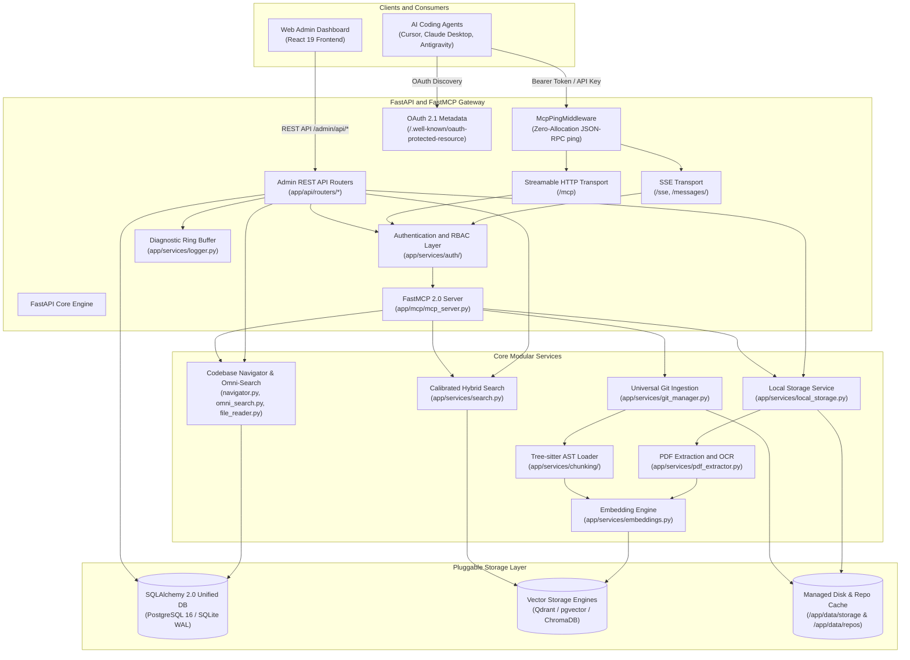

# System Design and Components

This document describes the runtime components of ContextCortex and their interactions across the client, gateway, core service, and storage layers.

---

## High-Level System Flowchart

The following diagram illustrates the system boundaries, client interfaces, core modular services, and storage engines:

---

## Component Breakdown

### 1. Client Layer
- **MCP Clients**: AI coding assistants (Cursor, Claude Desktop, Antigravity, Windsurf) and MCP gateways (such as Model Context Gateway) communicate via JSON-RPC 2.0 over Server-Sent Events (`/sse` + `/messages/`) or Streamable HTTP (`/mcp`).
- **Admin Dashboard**: React 19 single-page application served at `/admin/` communicating over REST API endpoints (`/admin/api/*`).

### 2. Gateway and Security Layer
- **FastAPI Lifespan Session Manager**: Manages application startup, database schema migrations, connection pool initialization, background auto-sync poller lifecycle, and graceful shutdown.
- **Zero-Allocation Ping Interceptor (`McpPingMiddleware`)**: Intercepts `POST /mcp`, `/sse`, and `/messages` requests carrying `"method": "ping"` and returns an immediate JSON-RPC 2.0 response without allocating SSE streams or AnyIO task groups.
- **Authentication Layer (`app/services/auth/`)**: Validates OAuth 2.1 JWT bearer tokens and SHA-256 hashed `cc_` API keys, and enforces 3-tier role-based permission checks (`viewer`, `editor`, `admin`).
- **Diagnostic Ring Buffer (`app/services/logger.py`)**: Captures the latest 500 server events, warnings, errors, and stack traces in bounded memory.

### 3. Core Processing Services
- **Universal Git Manager (`app/services/git_manager.py`)**: Handles authenticated shallow repository clones (`--depth 1`) across GitHub, GitLab, Gitea, Forgejo, Bitbucket, and generic Git hosts, supporting both ephemeral deletion and persistent shallow retention (`keep_shallow`).
- **Tree-sitter Chunking Package (`app/services/chunking/`)**: Parses 10 programming languages to extract AST declarations, parameter signatures, REST API routes, HTTP client calls, and caller/callee relationships.
- **Embedding & Gateway Engine (`app/services/embeddings.py`, `llm_client.py`, `litellm_service.py`)**: Generates 384-dimensional dense vectors (`FastEmbed BAAI/bge-small-en-v1.5` or upstream LiteLLM/OpenAI API embeddings) and sparse BM25 lexical vectors, while enforcing versioned gateway URL resolution, CR/LF-validated extra request headers (`LLM_EXTRA_HEADERS`), and database-backed settings fallback.
- **Calibrated Hybrid Search Engine (`app/services/search.py`)**: Fuses dense cosine similarity and sparse BM25 lexical scores using configurable hybrid weights (`dense_weight`, `mode`), decomposes component scores (`dense_score`, `sparse_score`), and enriches code matches with AST signatures from `ast_symbols`.
- **Codebase Navigator, File Reader & Summarizer (`navigator.py`, `omni_search.py`, `file_reader.py`, `summarizer.py`)**: Powers directory trees, symbol outlines, `Ctrl+K` Omni-Search, full syntax-highlighted file reading, and LLM executive summaries for large files with automatic client refresh when gateway settings change.
- **PDF Extraction Service (`app/services/pdf_extractor.py`)**: Extracts digital text from PDF files with automated AI vision OCR fallback for scanned pages and embedded architectural diagrams.
- **Container Trust & Mirror Bootstrap (`docker-entrypoint.sh`, `Dockerfile`, `Dockerfile.overlay`)**: Synchronizes private CA certificates (`certs/*.crt` / `EXTRA_CA_CERTS_DIR`) into the container trust store at both build time and runtime (`update-ca-certificates`) and supports restricted-network mirror overrides (`APT_MIRROR`, `NPM_REGISTRY`, `PIP_INDEX_URL`).

### 4. Pluggable Storage Layer
- **Unified Relational Database**: SQLAlchemy 2.0 Core schema operating identically over PostgreSQL 16 (`psycopg3` connection pool) and SQLite (WAL mode).
- **Pluggable Vector Store**: Runtime-switchable vector adapters for Qdrant (embedded or remote), PostgreSQL `pgvector` (HNSW cosine index), and ChromaDB.

---

## Related Architecture Guides
- [Data Pipeline and Ingestion](/architecture/data-pipeline)
- [MCP Protocol and Security](/architecture/mcp-protocol)
- [Database and Storage Schema](/architecture/database-schema)
