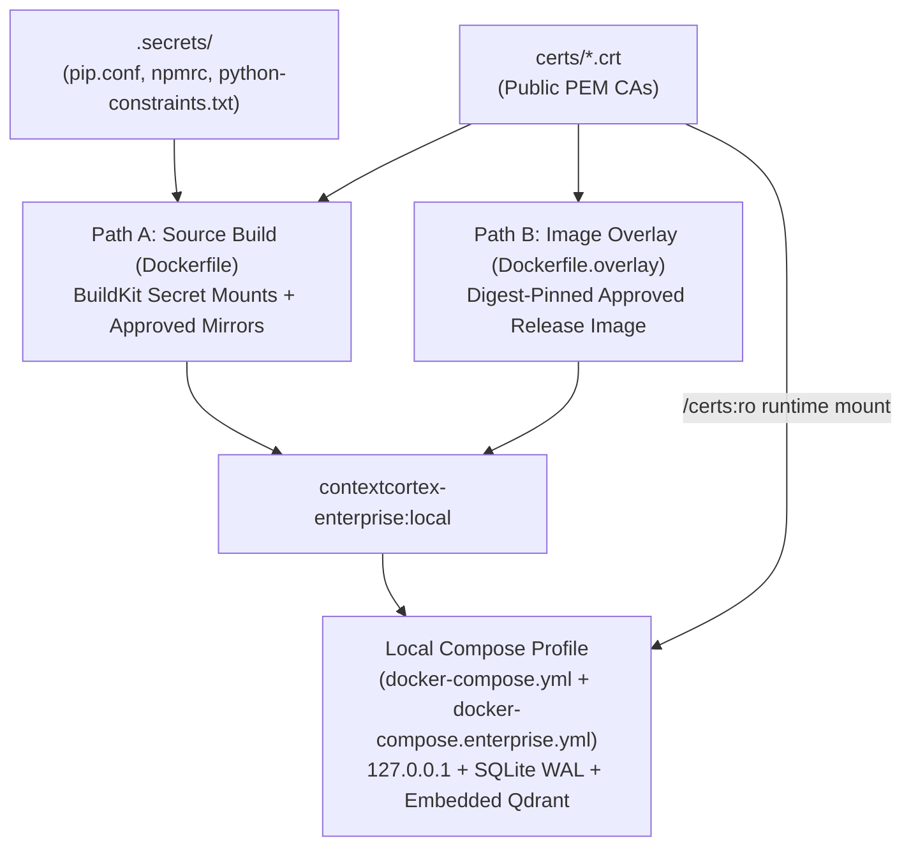

# Restricted-network builds and local deployment

There are two supported build paths. A **source build** installs Python and npm
dependencies from your approved sources. An **image overlay** applies this
checkout's application and bundled dashboard to an approved ContextCortex release
image, without contacting Python or npm registries. The latter does not prove
that the dependencies in the base image satisfy your package-age policy.



Use Docker with BuildKit and Docker Compose 2.24.4 or newer. Run commands from
the checkout root. The PowerShell examples use backticks for line continuation.
Do not use `setup.ps1` or `setup.sh` for the controlled build below: those are
developer setup scripts, not an age-locked enterprise installer.

## Private trust and configuration

Copy the public PEM certificates for your private certificate authorities into
`certs` as `.crt` files. Never put private keys there. Certificates are used at
build time and from the read-only `/certs` mount at runtime. Registry trust used
by Docker to pull images must also be configured in Docker Desktop/the daemon;
certificates copied into an image cannot fix the daemon's registry trust.

Create your runtime `.env` from `.env.example` and configure the approved gateway:

```dotenv
EMBEDDING_PROVIDER=api
LITELLM_URL=https://gateway.example.com/api/v3
LITELLM_API_KEY=replace-with-your-issued-key
LLM_EXTRA_HEADERS={"X-User-Agent":"contextcortex","X-User-Name":"your-service-identity"}
EMBEDDING_MODEL=your-approved-embedding-model
CHAT_MODEL=your-approved-chat-model
VISION_OCR_MODEL=your-approved-vision-model
```

Use the headers and models actually required by your gateway. These are examples,
not organization-specific defaults. Database-persisted settings take priority
after initial seeding; update existing settings in the UI when changing gateway
configuration. Even API embedding mode attempts a local sparse model. Provision
its assets or allow its approved download source; do not assume gateway mode
eliminates all model downloads. The selected parser-package version may also
need grammar assets. Verify actual AST extraction and hybrid search, not just
the health endpoint.

Keep package-registry credentials in a local `.secrets` directory (ignored by Git
and excluded from the Docker context), or outside the checkout. Pass them using
BuildKit secret mounts, not `COPY`, build arguments, or image environment
variables. Do not commit internal hostnames, credentials, certificates, or your
runtime `.env`.

## Source build through approved package mirrors

Supply a container-compatible pip configuration in `.secrets\pip.conf`:

```ini
[global]
index-url = https://packages.example.com/pypi/simple
```

Use the organization's approved authentication mechanism. If authentication
requires credentials in this file, keep it private. Do not add public PyPI as an
`extra-index-url` or disable TLS verification. The image sets `PIP_CERT` to its
system bundle, which includes `certs` certificates.

Supply `.secrets\npmrc` for the npm registry and its approved authentication:

```ini
registry=https://packages.example.com/npm/
```

Do not reuse host-only certificate paths in either file. The frontend's Git dependencies use Git's system CA bundle; npm's registry
setting does not redirect `github:` dependencies. The two development packages
`playwright-layout-inspector` and `vite-plugin-theme-editor` currently come from
GitHub. Your build needs approved access to their locked Git commits, or your
organization must arrange approved replacement artifacts. Both npm lockfiles omit registry-specific `resolved` URLs, while retaining
versions, integrity hashes and locked Git commits. This lets npm obtain each
registry tarball URL from the configured mirror's metadata instead of assuming
the public registry's URL layout. When updating locks, run
`npm install --package-lock-only --ignore-scripts --omit-lockfile-registry-resolved=true`
from the corresponding package directory. Check actual fetch destinations on
the restricted network.

Git dependency preparation also installs each helper's own build dependencies.
Its nested lockfile is not rewritten by the parent project's lockfile changes.
If preparation fails with `legacy-tarball-layout`, arrange compatible helper
artifacts/lockfiles or mirror support for those tarball requests. Do not disable
preparation scripts or fall back to public npm to hide the failure. The local
frontend-only build currently reaches this blocker in a Git helper dependency.

### The 30-day quarantine

Let the internal mirror enforce its package-age policy; a package being
available on public PyPI is not authorization to fetch it. For repeatability,
provide `.secrets\python-constraints.txt` containing the complete reviewed
direct and transitive version set for the target Python/OS/architecture, using
`package==version` lines. Include build dependencies where source distributions
are allowed. Match the Python version in `PYTHON_IMAGE`; current default is 3.11.

Generate/review that file from an eligible mirror snapshot, recording the
approval date and the organization's definition of release age. A constraints
file alone does not certify age or make a missing package available. Do not
invent older pins or lower package minimums without compatibility testing.
This repository does not ship an unverified enterprise lock.

You can check resolution on a configured host without installing anything:

```powershell
python -m pip install --dry-run --ignore-installed `
  --constraint .secrets\python-constraints.txt -r requirements.txt
```

A "No matching distribution" result requires checking mirror approval/import,
age eligibility, Python version and platform wheels. In the assessed environment,
Qdrant, FastEmbed and the tree-sitter language pack were unavailable in compatible
mirror probes. Those must be admitted as eligible packages (including their
transitive dependencies) before a source build can succeed. Selecting another
vector backend is not sufficient to remove them from the current imports.

Build with your approved configurations and constraints:

```powershell
docker build --file Dockerfile --tag contextcortex-enterprise:local `
  --secret id=pip_config,src=.secrets\pip.conf `
  --secret id=npmrc,src=.secrets\npmrc `
  --secret id=python_constraints,src=.secrets\python-constraints.txt .
```

The secrets are optional for ordinary public-network developer builds. If a
supplied constraints file cannot resolve, the build fails; it does not retry
without the constraints. Do not run the unconstrained form as a quarantine
workaround. Secret content changes do not invalidate BuildKit caches; use
`--no-cache` when validating a changed mirror policy, credential configuration or
approved version baseline.

To use promoted base images, add `--build-arg FRONTEND_IMAGE=...` and
`--build-arg PYTHON_IMAGE=...`, preferably digest-pinned. They must retain the
Alpine Node and Debian Python layout used by this Dockerfile. Docker image
registries, apt/apk OS package sources and the Dockerfile frontend image also
need approved reachability; pip/npm configuration does not configure those.
If your network requires proxies, Docker's predefined `HTTP_PROXY`,
`HTTPS_PROXY` and `NO_PROXY` build arguments are supported. Do not persist
credential-bearing proxy URLs in the image.

## Build an overlay without package-registry access

Use this when you already have an approved ContextCortex release image with
compatible dependencies and want to build these integration changes locally:

```powershell
docker build --file Dockerfile.overlay --tag contextcortex-enterprise:local `
  --build-arg RUNTIME_IMAGE=your-approved-contextcortex-image@sha256:your-digest .
```

`RUNTIME_IMAGE` is intentionally required; there is no implicit mutable `latest`
fallback. Use a release image matching this checkout's requirements and verify
compatibility. Review/scan/promote the base image according to enterprise policy.
This build uses the checked-in dashboard bundle, not a new npm build, and does
not upgrade dependencies. Dependency upgrades require a new approved base/source
build. Private CAs and the runtime entrypoint are included.

## Run the built image

Prepare `.env` and `certs`. Make an explicit storage choice; the tested local
profile is SQLite plus embedded Qdrant:

```dotenv
ENTERPRISE_DATABASE_URL=sqlite:////app/data/index_cache.db
ENTERPRISE_VECTOR_STORE_PROVIDER=qdrant
VECTOR_STORE_STORAGE_PATH=/app/data/vector_storage
```

The database URL and `ENTERPRISE_CACHE_DB_PATH` (default
`/app/data/index_cache.db`) must identify the same SQLite file. The override
requires the database/backend variables instead of silently changing an existing
installation. Use a new Compose project for an initial local deployment, with
an available `PORT`; this creates separate named data volumes:

```powershell
docker compose --project-name contextcortex-enterprise `
  --file docker-compose.yml --file docker-compose.enterprise.yml up --detach --no-build
```

The default deployment image is `contextcortex-enterprise:local`. Set
`CONTEXTCORTEX_IMAGE` in the shell or `.env` to deploy a different approved image.
The enterprise override removes `build`, so Compose does not silently install
dependencies again. Explicit `--file` arguments also prevent an ignored local
`docker-compose.override.yml` from selecting a different Dockerfile.

The bundled PostgreSQL service is opt-in via the `bundled-postgres` profile, not
an implicit requirement for local SQLite. This assessment found that selecting
PostgreSQL does not move legacy indexing/repository SQL off SQLite; the existing
local PostgreSQL configuration had no schema in that legacy SQLite file.
**Do not treat PostgreSQL indexing as verified.** Completing that migration is
separate from this tested local profile.

The local profile binds to `127.0.0.1` by default. Set `ENTERPRISE_BIND_ADDRESS`
only if you deliberately need another bind address, with appropriate access
controls. Ports, authentication settings and saved-setting precedence remain configurable
as in the base Compose file. The override removes fixed container names so an
isolated project can coexist with your current installation on a different port.
Do not change project names or delete volumes when updating an established
installation unless you intend fresh storage. Do not point the SQLite profile
at existing PostgreSQL metadata and assume a migration occurred. Review
`docker compose ... config --quiet` for configuration validity;
avoid sharing rendered configurations, which contain secrets.

For runtime proxies, put the needed `HTTP_PROXY`, `HTTPS_PROXY` and `NO_PROXY` in
the runtime `.env`. Include internal gateway, Git, IdP and storage destinations
in `NO_PROXY` where required by your network. Build arguments do not configure
runtime proxies, and runtime `.env` does not configure build-time registries.

## Prove the deployment works

1. Confirm the container starts and `/health` responds.
2. In Settings, confirm gateway discovery, embedding, summary and OCR requests
   use the approved URL, headers and private CA.
3. Add a small approved repository or upload a document. Confirm completed
   indexing, nonzero chunks, expected AST symbols and a known-answer search over
   both the dashboard and the MCP transport you use.
4. Restart and confirm indexed content and settings persist without unexpected
   model/grammar downloads. Check logs for sparse-model/parser initialization
   failures; HTTP 200 from `/health` alone does not prove indexing/search works.

An unavailable gateway, missing eligible mirror package, or absent model asset
is a deployment blocker to diagnose explicitly, not a reason to disable TLS,
silently change storage/provider, or bypass quarantine.
